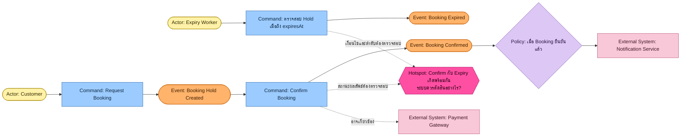

# Big Picture Event Storming

> **TOOL-001 · DD-01**  
> Collaborative Discovery Technique · Domain Exploration · Strategic DDD

## วัตถุประสงค์

สำรวจภาพรวมของธุรกิจโดยให้ผู้เกี่ยวข้องช่วยกันค้นหาและเรียงลำดับเหตุการณ์สำคัญที่เกิดขึ้นจริง เพื่อทำความเข้าใจ Business Flow ผู้เกี่ยวข้อง จุดเชื่อมต่อระหว่างกระบวนการ และประเด็นที่ยังไม่ชัดเจน

Tool นี้ช่วยตอบคำถามว่า:

- ธุรกิจนี้เกิดเหตุการณ์อะไรขึ้นบ้าง และเหตุการณ์เหล่านั้นเชื่อมโยงกันอย่างไร?
- ใครหรือระบบใดเกี่ยวข้องกับแต่ละเหตุการณ์?
- มีข้อมูลใดไม่ชัดเจน หรือผู้เกี่ยวข้องมีความเห็นไม่ตรงกัน?
- ควรสำรวจ Domain ส่วนใดต่อไป?

## Properties

| Property | Description |
|---|---|
| ID | TOOL-001 / DD-01 |
| Name | Big Picture Event Storming |
| Category | Collaborative Discovery Technique |
| Purpose | สำรวจภาพรวมของ Business Domain |
| Scope | Business Domain หรือกระบวนการขนาดใหญ่ |
| Abstraction Level | Big Picture / Strategic Exploration |
| Input | TOR, Requirements, ความรู้จากผู้เกี่ยวข้อง และข้อมูลกระบวนการปัจจุบัน |
| Primary Output | Business Event Timeline |
| Supporting Output | Business Flow, Actors, External Systems และ Hotspots |
| Participants | Domain Experts, ผู้ปฏิบัติงาน, Developer และผู้เกี่ยวข้อง |
| Prerequisites | ไม่จำเป็นต้องมี Domain Model หรือ Architecture มาก่อน |
| Decision Supported | ทำความเข้าใจ Business Flow และระบุหัวข้อสำหรับการสำรวจ Domain ต่อ |
| Related Tools | Domain Storytelling, Process Modeling, Example Mapping และ Strategic DDD |
| Limitations | ไม่ได้กำหนด Subdomain, Bounded Context, Aggregate หรือ Architecture ให้โดยอัตโนมัติ |

## Terms & Concepts

ตัวอย่างด้านล่างใช้ระบบจองทรัพยากร (Booking System) เพื่ออธิบายคำที่ใช้ระหว่างการสำรวจ

### Domain Event — เหตุการณ์ทางธุรกิจ

ข้อเท็จจริงที่มีความหมายต่อธุรกิจและเกิดขึ้นแล้ว มักตั้งชื่อเป็นอดีตกาล เช่น `Booking Confirmed`, `Booking Cancelled` หรือ `Booking Expired` ใช้ค้นหาว่าเกิดอะไรขึ้นในธุรกิจและสร้าง Timeline ของเหตุการณ์

### Command — คำสั่ง

การร้องขอหรือความตั้งใจให้เกิดการกระทำหรือการเปลี่ยนแปลง ซึ่งอาจสำเร็จหรือถูกปฏิเสธก็ได้ เช่น `Request Booking`, `Confirm Booking` หรือ `Cancel Booking` ใช้สำรวจว่าอะไรเป็นตัวกระตุ้นให้เกิดการเปลี่ยนแปลงใน Business Flow

### Actor — ผู้กระทำหรือผู้มีบทบาท

บุคคล บทบาท กลุ่มผู้ใช้ หรือระบบที่เริ่มคำสั่งหรือมีส่วนร่วมในกระบวนการ เช่น `Customer`, `Booking Administrator` หรือ `Expiry Worker`

### Policy — กฎที่เชื่อมเหตุการณ์กับการตอบสนอง

กฎที่กำหนดว่าเมื่อเกิดเหตุการณ์หนึ่งแล้วควรพิจารณาหรือดำเนินการอะไรต่อ โดยเฉพาะกฎลักษณะ “เมื่อเกิด X ให้พิจารณาสั่ง Y” เช่น เมื่อ Booking ได้รับการยืนยัน ให้ส่งการแจ้งเตือนแก่ลูกค้า Policy ที่พบอาจยังต้องสำรวจเงื่อนไขเพิ่มเติม

### Hotspot — จุดที่ต้องสำรวจเพิ่มเติม

คำถาม ความไม่แน่นอน ความเห็นขัดแย้ง หรือปัญหาที่พบระหว่างการสำรวจ เช่น หากการยืนยัน Booking และการหมดอายุของ Hold เกิดขึ้นพร้อมกัน ระบบควรตัดสินอย่างไร ให้บันทึกไว้เป็นประเด็นเปิด ห้ามถือว่าสมมติฐานที่ยังไม่ผ่านการตรวจสอบเป็น Business Rule ที่ยืนยันแล้ว

### External System — ระบบภายนอก

ระบบหรือหน่วยงานนอกขอบเขตที่กำลังสำรวจ แต่มีปฏิสัมพันธ์กับกระบวนการ เช่น Payment Gateway, Notification Service หรือระบบบริหารทรัพยากรของหน่วยงานอื่น ช่วยให้เห็นการพึ่งพา การส่งต่อข้อมูล และจุดที่อาจต้องสำรวจ Integration เพิ่มเติม

### Business Process — กระบวนการทางธุรกิจ

ภาพรวมของกิจกรรมและเหตุการณ์ที่เชื่อมโยงกันเพื่อบรรลุผลลัพธ์ทางธุรกิจ เช่น ลูกค้าค้นหาทรัพยากร → สร้าง Booking Hold → ยืนยันการจอง → ได้รับการแจ้งเตือน เป็นสิ่งที่สังเคราะห์จากภาพรวม ไม่ใช่ Sticky Note ประเภทเฉพาะที่ต้องสร้างทุกครั้ง

> สีและสัญลักษณ์เป็นแนวทางประกอบภาพ ควรใช้ Legend ที่ผู้เข้าร่วมเข้าใจตรงกัน และไม่ควรผูกความหมายของ Domain Event กับรูปแบบการจัดเก็บ Event ในระบบโดยอัตโนมัติ

## Example Artifact

ตัวอย่างลำดับเหตุการณ์และคำถามจากระบบจองทรัพยากร ใช้สี Event Storming ที่พบได้ทั่วไป: Event สีส้ม, Command สีน้ำเงิน, Actor สีเหลือง, Policy สีม่วงอ่อน, External System สีชมพู และ Hotspot สีชมพูเข้ม

สีเป็น convention ที่ใช้กันทั่วไปเพื่อช่วยอ่านภาพ ไม่ใช่มาตรฐานตายตัว ควรแสดง Legend และตกลงความหมายกับผู้เข้าร่วมก่อน Workshop

ตัวอย่างนี้ใช้เพื่ออธิบายแนวคิดเท่านั้น ไม่ใช่ผล Event Storming ที่ผ่านการยืนยันกับ Domain Expert แล้ว เส้นทางหรือความสัมพันธ์ที่ยังไม่ตรวจสอบเป็นสมมติฐาน ไม่ใช่ข้อกำหนดระบบ

สิ่งที่ควรอ่านได้จากตัวอย่าง:

- `Booking Hold Created` เป็นเหตุการณ์ที่เกิดขึ้นแล้ว ขณะที่ `Confirm Booking` เป็นคำสั่ง
- การหมดอายุของ Hold เป็นอีกเส้นทางหนึ่ง ซึ่งอาจนำไปสู่ `Booking Expired`
- Policy แสดงการตอบสนองที่อาจเกิดหลัง Booking ได้รับการยืนยัน
- Hotspot ชี้ว่าการแข่งขันระหว่าง Confirm กับ Expiry ต้องมีกฎที่ชัดเจน
- External System ช่วยให้เห็นความสัมพันธ์กับระบบนอกขอบเขต

## Usage Guidelines

### When to use

ใช้ Big Picture Event Storming เมื่อ:

- ยังไม่เข้าใจภาพรวมของธุรกิจหรือกระบวนการทำงาน
- TOR ระบุความต้องการ แต่ยังไม่เห็น Business Flow ชัดเจน
- หลายบทบาทหรือหลายหน่วยงานเข้าใจกระบวนการไม่ตรงกัน
- ต้องการค้นหา Events, การส่งต่องาน, ระบบภายนอก หรือจุดที่มีปัญหา
- ต้องการข้อมูลเพื่อพิจารณา Subdomains หรือแนวทางสำรวจ Domain ในขั้นถัดไป

### When not to use

ไม่ควรเริ่มโดยอัตโนมัติเมื่อ:

- Business Flow ชัดเจน ผ่านการตรวจสอบ และผู้เกี่ยวข้องเข้าใจตรงกันแล้ว
- คำถามมีขอบเขตแคบและต้องการเจาะ Business Rules เฉพาะจุด
- เป้าหมายคือออกแบบรายละเอียดเชิงเทคนิค เช่น Database Schema, API Contract หรือ Aggregate Invariants
- ไม่มีช่องว่างด้านความเข้าใจภาพรวมที่ Tool นี้จะช่วยแก้ได้อย่างมีนัยสำคัญ

กรณีเหล่านี้ให้พิจารณา Tool ที่ตรงกับช่องว่างความรู้ เช่น Example Mapping สำหรับสำรวจกฎ หรือ Process Modeling สำหรับรายละเอียดลำดับกิจกรรม

### How to use

1. **กำหนดขอบเขตการสำรวจ** — ระบุธุรกิจหรือกระบวนการ ผู้เกี่ยวข้อง และคำถามที่ Workshop ต้องตอบ
2. **ค้นหา Domain Events** — ให้ผู้เข้าร่วมระบุสิ่งที่เกิดขึ้นจริง แล้วเรียงตามลำดับเวลาโดยใช้ภาษาที่เข้าใจร่วมกัน
3. **เชื่อมโยงภาพรวม** — ตรวจสอบลำดับ Events และเพิ่ม Actors หรือ External Systems ตามหลักฐานที่ค้นพบ
4. **เพิ่ม Commands และ Policies เมื่อจำเป็น** — สำรวจว่าอะไรนำไปสู่เหตุการณ์ และกฎใดกำหนดการตอบสนอง โดยไม่จำเป็นต้องลงรายละเอียดทั้งหมดในรอบ Big Picture
5. **ทำเครื่องหมาย Hotspots** — บันทึกข้อสงสัย ความขัดแย้ง และสมมติฐานให้เห็นชัด พร้อมแนวทางตรวจสอบต่อ
6. **ประเมินผลและเลือกขั้นถัดไป** — ตรวจสอบว่าเข้าใจ Business Flow เพียงพอหรือยัง แล้วเลือก Tool สำหรับคำถามที่เหลือโดยไม่ยึดลำดับตายตัว

### Common Mistakes

- เริ่มจาก Database Tables, API Endpoints หรือ Technical Components แทน Business Events
- สับสนระหว่าง Command ที่ร้องขอการกระทำ กับ Event ที่ยืนยันว่าเกิดขึ้นแล้ว
- คิดว่า Actor ต้องเป็นมนุษย์เท่านั้น
- มอง Policy ว่าเป็น Business Rule ทุกชนิด ทั้งที่บางกฎเป็นเงื่อนไขเฉพาะของการประมวลผล
- ตัดสินใจแทน Domain Expert เมื่อยังมี Hotspots ที่ไม่ได้รับคำตอบ
- ลงรายละเอียด Business Rules และ Architecture มากเกินไปจนภาพรวมไม่ชัดเจน

### Exit Criteria

จบรอบการสำรวจได้เมื่อ:

- [ ] มี Business Event Timeline ที่ผู้เกี่ยวข้องช่วยตรวจสอบแล้ว
- [ ] อธิบาย Business Flow และบทบาทสำคัญได้
- [ ] ระบุ External Systems หรือการส่งต่องานที่มีผลต่อกระบวนการได้
- [ ] บันทึก Hotspots และประเด็นที่ยังไม่แน่นอนไว้แล้ว
- [ ] ระบุได้ว่าควรสำรวจอะไรต่อ หรือมีข้อมูลเพียงพอสำหรับเป้าหมายของรอบนี้แล้ว

## Expected Output

- **Business Event Timeline:** เหตุการณ์สำคัญที่เรียงตามลำดับ
- **Business Flow:** ภาพรวมการดำเนินธุรกิจ
- **Actors:** บทบาทที่เริ่มคำสั่งหรือมีส่วนร่วม
- **External Systems:** ระบบภายนอกที่เกี่ยวข้อง
- **Hotspot Register:** คำถาม ความขัดแย้ง และความไม่แน่นอน
- **Next Discovery Actions:** สิ่งที่ควรสำรวจต่อ พร้อมเหตุผลในการเลือก Tool

## Related Tools

| Tool | ใช้ต่อเมื่อ |
|---|---|
| [[Domain Storytelling]] | ต้องการสำรวจปฏิสัมพันธ์ระหว่างคน ระบบ และกิจกรรมจริง |
| [[Process Modeling]] | ต้องการรายละเอียดลำดับกิจกรรม การตัดสินใจ และเส้นทางต่าง ๆ |
| [[Example Mapping]] | ต้องการเจาะ Business Rules, Examples และ Questions |
| [[Subdomain Classification]] | ต้องการจำแนก Subdomains หรือสำรวจ Bounded Contexts |

ความสัมพันธ์เหล่านี้เป็นแนวทางเลือกเครื่องมือ ไม่ใช่ลำดับบังคับที่ทุก Project ต้องทำครบทุกตัว

## แหล่งข้อมูลและความสัมพันธ์

- แหล่งที่มาของเนื้อหา: Tool Profile — Big Picture Event Storming ที่ผู้ใช้ให้มา
- [[inbox/domain-discovery-toolkit/notes/Tool Catalog|Tool Catalog]] — รายการ DD-01 และเกณฑ์เลือกเครื่องมือ
- [[inbox/domain-discovery-toolkit/overview|Domain Discovery Toolkit - Overview]] — ภาพรวมชุดเครื่องมือ
- [[inbox/domain-discovery-toolkit/references|แหล่งอ้างอิง]] — แหล่งข้อมูลสำหรับตรวจสอบเพิ่มเติม

> **สถานะ:** ร่าง — เนื้อหานี้ถอดจาก Tool Profile ที่ให้มาและยังไม่ได้ตรวจสอบกับแหล่งอ้างอิงภายนอก
